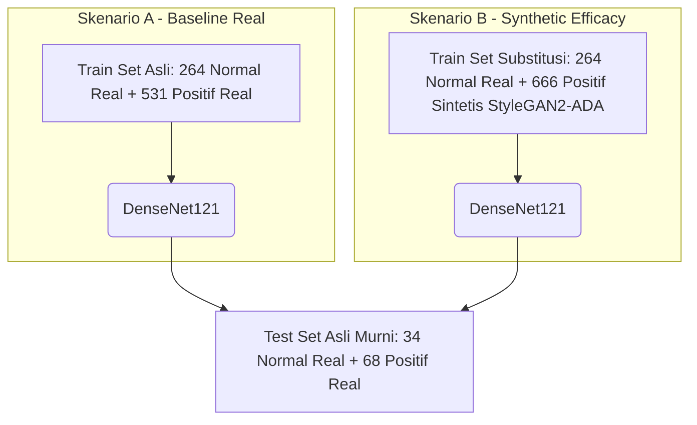

# Laporan Metodologi dan Hasil Eksperimen Skripsi

Dokumen ini menyajikan metodologi lengkap, formulasi matematis, konfigurasi eksperimen, kronologi pelatihan, serta analisis hasil komparasi generatif (*StyleGAN2-ADA* vs *StyleGAN3*) dan pengujian efikasi data sintetis pada klasifikasi CNN (*DenseNet121*). 

Dokumen ini disusun secara terstruktur agar mudah disalin atau dijadikan bahan masukan (*prompt/context*) bagi kecerdasan buatan (AI) lain dalam menulis Bab II, III, dan IV skripsi Anda.

---

## BAB I: LANDASAN METODE & ARSITEKTUR MODEL

### 1.1 Metodologi Generative Adversarial Networks (GAN)
*Generative Adversarial Networks* (GAN) terdiri dari dua jaringan saraf tiruan yang dilatih secara bersamaan dalam permainan teori *minimax* nol-jumlah (*zero-sum game*):
1. **Generator ($G$)**: Berfungsi menangkap distribusi probabilitas data asli $p_{data}$ untuk mensintesis citra tiruan baru dari vektor *noise* acak $z \in p_z(z)$.
2. **Discriminator ($D$)**: Berfungsi sebagai klasifikator biner yang membedakan apakah sebuah citra berasal dari data asli ($x \sim p_{data}$) atau data sintetis hasil generator ($G(z)$).

Fungsi tujuan permainan *minimax* tersebut dirumuskan secara matematis sebagai berikut:
$$\min_G \max_D V(D, G) = \mathbb{E}_{x \sim p_{data}(x)}[\log D(x)] + \mathbb{E}_{z \sim p_z(z)}[\log (1 - D(G(z)))]$$

---

### 1.2 Arsitektur StyleGAN2 dengan Adaptive Data Augmentation (StyleGAN2-ADA)
StyleGAN2 merevolusi pemodelan generatif melalui pemetaan *noise* acak $z \in \mathcal{Z}$ menjadi gaya perantara $w \in \mathcal{W}$ menggunakan *Mapping Network* (8 lapisan *Fully Connected*). Gaya $w$ digunakan untuk memodulasi filter konvolusi pada jaringan sintesis (*Synthesis Network*).

#### 1.2.1 Weight Demodulation
Untuk menghilangkan artefak tetesan air (*water droplet artifacts*) yang sering muncul pada StyleGAN versi pertama akibat normalisasi AdaIN, StyleGAN2 menerapkan operasi *Weight Demodulation*:
1. **Modulasi**: Nilai bobot konvolusi $w'_{i,j,k}$ dikalikan dengan skala gaya $s_i$ untuk fitur input ke-$i$:
   $$w'_{i,j,k} = s_i \cdot w_{i,j,k}$$
   di mana $i$ melambangkan kanal input, $j$ kanal output, dan $k$ posisi spasial kernel.
2. **Demodulasi**: Bobot hasil modulasi dinormalisasi berdasarkan standar deviasi outputnya untuk menjaga stabilitas amplitudo gradien:
   $$w''_{i,j,k} = \frac{w'_{i,j,k}}{\sqrt{\sum_{i,k} (w'_{i,j,k})^2 + \epsilon}}$$
   di mana $\epsilon$ adalah konstanta numerik kecil untuk mencegah pembagian dengan nol.

#### 1.2.2 Adaptive Data Augmentation (ADA)
Saat dilatih pada *limited data regime* (dalam kasus ini 666 citra positif), diskriminator konvensional akan dengan cepat mengalami *overfitting*. Diskriminator menghafal seluruh citra asli dan memberikan skor penolakan mutlak pada generator, menyebabkan gradien terhenti dan pelatihan mengalami kolaps (*training collapse*).

Mekanisme ADA memecahkan masalah ini dengan menerapkan augmentasi citra secara dinamis (seperti translasi, rotasi, perubahan warna) baik pada data asli maupun sintetis sebelum masuk ke diskriminator dengan probabilitas $p \in [0, 1]$. Nilai $p$ dikontrol secara adaptif berdasarkan tingkat *overfitting* diskriminator:
* Jika diskriminator mulai menunjukkan *overfitting* (ditandai dengan divergensi nilai keluaran citra asli dan palsu), nilai $p$ ditingkatkan secara otomatis menuju 1.0.
* Jika diskriminator stabil, nilai $p$ diturunkan atau ditahan.
Augmentasi ini dirancang agar tidak bocor (*non-leaking*), sehingga generator dilatih untuk mensintesis citra serviks bersih bebas efek augmentasi.

---

### 1.3 Arsitektur StyleGAN3 (Equivariant GAN)
StyleGAN3 dirancang untuk mengatasi masalah *texture sticking* (di mana tekstur detail seperti pori-pori atau pembuluh darah menempel pada posisi absolut layar saat gambar digeser atau diputar, alih-alih mengikuti gerakan visual objek).

#### 1.3.1 Prinsip Ekuivariansi Spasial (*Spatial Equivariance*)
StyleGAN3 mendesain ulang operasi konvolusi agar bersifat ekuivarian secara spasial terhadap translasi ($T$) dan rotasi ($R$). Secara matematis, operasi jaringan sintesis $g(z)$ harus memenuhi sifat:
$$g(T_v(z)) = T_v(g(z)) \quad \text{dan} \quad g(R_\theta(z)) = R_\theta(g(z))$$
Hal ini dicapai dengan:
* Menghilangkan representasi koordinat absolut spasial.
* Mengganti konvolusi konvensional dengan operasi konvolusi kontinu menggunakan filter rekonstruksi sinyal berbasis filter Kaiser untuk menekan efek *aliasing* frekuensi tinggi.

#### 1.3.2 Keterbatasan StyleGAN3 pada Data Terbatas (*Data Scarcity*)
Kendati StyleGAN3 sukses menghasilkan citra ekuivarian yang stabil saat diputar, pembatasan ekuivariansi spasial yang ketat tersebut membuat jaringan kehilangan fleksibilitas spasial. Pada *dataset* kecil (seperti 666 citra serviks IVA), model memerlukan data dan durasi komputasi yang jauh lebih masif untuk mempelajari detail lesi patologis lokal yang halus (*acetowhite*). Akibatnya, pada waktu latih yang setara, StyleGAN3 menghasilkan kualitas visual dan skor FID yang lebih rendah dibandingkan StyleGAN2-ADA yang lebih fleksibel.

---

### 1.4 Metrik Evaluasi Generatif: Fréchet Inception Distance (FID)
FID mengukur kesamaan statistik antara distribusi citra asli ($r$) dan citra sintetis ($g$). Citra diproyeksikan ke dalam ruang fitur berdimensi 2048 menggunakan model klasifikasi *Inception-v3* yang telah dilatih pada *ImageNet*. 

Secara matematis, FID dihitung sebagai jarak Wasserstein-2 antara dua distribusi Gaussian multivariat:
$$\text{FID}(r, g) = \|\mu_r - \mu_g\|^2_2 + \text{Tr}(\Sigma_r + \Sigma_g - 2(\Sigma_r\Sigma_g)^{1/2})$$
Di mana:
* $\mu_r$ dan $\Sigma_r$ mewakili vektor rata-rata (*mean*) dan matriks kovariansi fitur citra asli.
* $\mu_g$ dan $\Sigma_g$ mewakili vektor rata-rata dan matriks kovariansi fitur citra sintetis.
* $\text{Tr}$ mewakili operasi *trace* matriks (penjumlahan elemen diagonal utama).
Semakin rendah skor FID, semakin mirip distribusi citra sintetis dengan citra asli.

---

### 1.5 Model Klasifikasi Downstream Task: DenseNet121
*Densely Connected Convolutional Networks* (DenseNet121) digunakan sebagai pengklasifikasi *downstream task* untuk mengukur efikasi data sintetis (*synthetic data efficacy*).

#### 1.5.1 Rasionalisasi Pemilihan DenseNet121
DenseNet121 dipilih berdasarkan beberapa keunggulan arsitektural dibandingkan arsitektur CNN populer lainnya:
1. **Penggunaan Kembali Fitur (*Feature Reuse*) vs ResNet**: ResNet menggunakan koneksi jalan pintas (*residual connections*) melalui operasi **penjumlahan** ($+ x_{l-1}$). Penjumlahan ini cenderung melemahkan aliran informasi fitur halus dari lapisan awal. Sebaliknya, DenseNet menerapkan operasi **konkatenasi** (penggabungan kanal). Hal ini membuat lapisan klasifikasi akhir memiliki akses langsung ke peta fitur resolusi tinggi (seperti tekstur kasar) yang diekstraksi di lapisan awal, yang sangat krusial untuk mendeteksi tepi lesi *acetowhite* tipis pada citra serviks IVA.
2. **Efisiensi Parameter & Risiko Overfitting Rendah**: DenseNet121 memiliki parameter yang jauh lebih sedikit (~7 juta parameter) dibandingkan ResNet50 (~25 juta parameter). Karena setiap lapisan saling terhubung rapat dan fitur digunakan kembali secara maksimal, model tidak perlu mempelajari ulang fitur redundan. Ini sangat menguntungkan saat melatih model pada *dataset* kecil (997 citra) guna meminimalisasi risiko *overfitting*.
3. **Kapasitas Pemodelan Tekstur Medis vs MobileNet**: Meskipun MobileNet sangat efisien (~3,2 juta parameter) karena menggunakan *Depthwise Separable Convolutions*, arsitektur ini dirancang khusus untuk perangkat seluler berdaya rendah. MobileNet sering kali mengorbankan kapasitas pemodelan relasi antar-kanal spasial yang kompleks. Pada citra medis IVA, variasi warna patologis yang halus memerlukan kapasitas pemodelan konvolusi standar yang dimiliki DenseNet121 agar tidak kehilangan detail diagnostik penting.

#### 1.5.2 Dense Connectivity
Pada DenseNet, setiap lapisan menerima *feature maps* tambahan dari seluruh lapisan sebelumnya sebagai input dan menyalurkan *feature maps*-nya sendiri ke seluruh lapisan berikutnya melalui operasi konkatenasi (*concatenation*):
$$x_l = H_l([x_0, x_1, \dots, x_{l-1}])$$
Di mana:
* $x_l$ melambangkan output lapisan ke-$l$.
* $[x_0, x_1, \dots, x_{l-1}]$ melambangkan operasi penyatuan (*concatenation*) seluruh peta fitur sebelumnya.
* $H_l$ melambangkan transformasi non-linier (terdiri dari *Batch Normalization*, *ReLU*, dan *Convolution*).

#### 1.5.3 Growth Rate ($k$)
Pertumbuhan jumlah kanal fitur diatur oleh parameter *Growth Rate* ($k$). Untuk DenseNet121, digunakan nilai pertumbuhan $k = 32$. Karakteristik ini membuat DenseNet121 sangat efisien dalam penggunaan parameter dan mengurangi risiko *overfitting* pada dataset berukuran kecil.

---

## BAB II: DATASET & PENGATURAN EKSPERIMEN

### 2.1 Dataset Asli dan Konfigurasi Eksperimen
* **Dataset**: Citra hasil skrining Inspeksi Visual Asam Asetat (IVA) yang menggabungkan data klinis lokal dan *dataset* publik.
  * **Kelas Negatif (Normal)**: 331 citra, diperoleh dari data rekam medis RSMH Palembang.
  * **Kelas Positif (Kanker Serviks)**: 666 citra, diperoleh dari penggabungan *dataset* publik *iclx AnnoCerv main dataset* dan *Malhari Dataset*.
* **Ukuran Dataset Asli**: 997 citra (331 Normal, 666 Positif).
* **Dimensi Target**: Resolusi citra dikurangi menjadi 128 × 128 piksel.
  * **Rasionalisasi Pemilihan Resolusi**:
    1. **Batasan Komputasi & Efisiensi VRAM**: Pemodelan generatif menggunakan StyleGAN memiliki kompleksitas komputasi yang sangat tinggi. Resolusi di atas 128x128 (seperti 256x256 atau 512x512) secara eksponensial akan meningkatkan konsumsi memori GPU dan memperlambat kecepatan latih. Pada resolusi 128x128, model dapat dilatih stabil pada platform Kaggle Dual Tesla T4 dengan penggunaan VRAM konstan di kisaran ~5.06 GB dan kecepatan pemrosesan rata-rata **42.9 detik per Kimg**.
    2. **Mitigasi Overfitting pada Data Terbatas**: Melatih model generatif dengan dataset kecil (666 citra positif) pada resolusi terlalu tinggi akan memicu ketidakstabilan spasial dan mempercepat kejenuhan diskriminator (*discriminator saturation*). Resolusi 128x128 terbukti menjadi titik optimal (*sweet spot*) yang menyajikan informasi tekstur patologis klinis penting (*acetowhite*, batas epitel) tanpa membebani kapasitas pembelajaran model.
    3. **Batasan Arsitektur StyleGAN**: Jaringan generator StyleGAN mensyaratkan input citra bertipe persegi (*square*) dengan dimensi bernilai pangkat dua (*power of two*, seperti 64, 128, 256). Resolusi 128x128 memenuhi syarat arsitektur ini secara efisien.
  * **Metode Resizing**: Citra asli memiliki aspek rasio persegi panjang **4:3** (berukuran `640 × 480` piksel dan `4000 × 3000` piksel). Karena tidak menggunakan parameter potong (`--transform=center-crop`), pemrosesan pada `dataset_tool.py` melakukan *direct resizing* (peregangan/penekanan secara langsung) menggunakan filter interpolasi **Lanczos** (`PIL.Image.LANCZOS`) ke dimensi persegi **1:1** (`128 × 128` piksel).
  * **Dampak Visual**: Hal ini menyebabkan citra mengalami kompresi horizontal (*horizontal squeezing*), sehingga sel dan struktur visual tampak sedikit lebih ramping dan tinggi dibandingkan proporsi aslinya. Namun, metode ini memastikan **tidak ada informasi batas klinis (*boundary*) yang hilang** akibat pemotongan (*cropping*).
* **Pembagian Dataset (Zero Data-Leakage)**:
  * **Train Set (80%)**: 795 citra (264 Normal, 531 Positif).
  * **Validation Set (10%)**: 100 citra (33 Normal, 67 Positif).
  * **Test Set (10%)**: 102 citra (34 Normal, 68 Positif).

---

### 2.2 Skenario Pengujian Efikasi Data Sintetis (*Synthetic Data Efficacy*)
Untuk membuktikan citra patologis sintetis memiliki kesetaraan fitur klinis dengan data asli, kami merancang dua skenario pelatihan model klasifikasi secara *head-to-head*:

* **Skenario A (Baseline)**: Model *DenseNet121* dilatih menggunakan *train set* asli yang mencakup citra kelas positif asli.
* **Skenario B (Efficacy)**: Seluruh citra positif asli pada *train set* dihapus dan digantikan 100% oleh citra positif sintetis hasil pembangkitan dari arsitektur generatif terbaik (*StyleGAN2-ADA*). Kelas negatif tetap menggunakan citra asli asli.
* **Evaluasi**: Kedua model diuji menggunakan *test set* asli murni yang sama persis (34 Normal, 68 Positif) untuk memperoleh perbandingan performa objektif.
  * **Rasionalisasi Pemuatan Citra Asli pada Validation & Test Set (Skenario B)**:
    1. **Tujuan Klinis Dunia Asli (*Real-World Clinical Target*)**: Tujuan akhir dari pembuatan sistem klasifikasi ini adalah untuk mendeteksi keberadaan kanker serviks pada **pasien nyata** menggunakan citra skrining IVA asli. Oleh karena itu, performa model harus diukur berdasarkan kemampuannya mendeteksi objek asli, bukan objek sintetis buatan komputer.
    2. **Validasi Efikasi Data Sintetis (*Synthetic Data Efficacy*)**: Jika *Validation Set* dan *Test Set* pada Skenario B diisi dengan data generatif/sintetis juga, maka skor akurasi yang tinggi hanya akan membuktikan bahwa model mampu mengklasifikasi citra buatan generator. Pengujian ini tidak akan membuktikan apakah citra sintetis tersebut memiliki **kesetaraan fitur klinis patologis** yang diakui secara medis untuk mendeteksi data asli.
    3. **Standarisasi dan Keadilan Pengujian Komparatif**: Untuk membandingkan Skenario A (*baseline* data asli) dan Skenario B (substitusi sintetis) secara adil, variabel penguji (*Validation* dan *Test set*) **wajib dijaga konstan dan identik (100% asli)**. Perubahan akurasi dari 97% ke 95% secara langsung membuktikan bahwa model latih sintetis mampu mentransfer pengetahuannya (*generalization*) ke domain asli dengan sangat baik.

---

### 2.3 Parameter Pelatihan (Hyperparameters)
#### 2.3.1 Parameter Model Generatif (StyleGAN)
* **Target Resolusi**: 128 × 128 piksel.
* **Batch Size**: 64 (StyleGAN2-ADA) | 32 (StyleGAN3).
* **Optimizer**: Adam ($\beta_1 = 0$, $\beta_2 = 0.99$, $\alpha = 0.0025$).
* **Probabilitas ADA Awal ($p$)**: 0.0 dengan *tuning* otomatis adaptif.
* **Inisialisasi Bobot (*Weight Initialization*)**: Pelatihan kedua model generatif (*StyleGAN2-ADA* dan *StyleGAN3*) dilakukan **dari nol (*from scratch*)**, bukan melalui teknik *transfer learning* dari model berbobot sebelum-latih (*pretrained weights*) seperti FFHQ atau MetFaces.
  * **Alasan Teknis**: 
    1. **Perbedaan Resolusi**: Bobot *pretrained* standar FFHQ dilatih pada resolusi $1024 \times 1024$ piksel. Penggunaan *transfer learning* pada resolusi target $128 \times 128$ piksel akan memicu ketidakcocokan arsitektur blok resolusi atas.
    2. **Perbedaan Domain Fitur**: FFHQ melatih fitur wajah manusia yang sangat teratur (posisi mata, hidung, mulut terikat pola spasial tertentu). Sebaliknya, citra serviks IVA lokal didominasi oleh tekstur patologis non-selaras (*unaligned*) dan gradasi warna sel. *Transfer learning* dari wajah manusia justru dapat memberikan bias spasial yang tidak relevan pada pemodelan tekstur sel medis.
  * **Mekanisme Resume**: Pelatihan bertahap memanfaatkan fitur *auto-resume* hanya untuk melanjutkan sesi pelatihan dari berkas penunjuk lokal (`.pkl`) hasil tahap pelatihan sebelumnya secara berkesinambungan.

#### 2.3.2 Parameter Model Klasifikasi (DenseNet121)
* **Pretrained Weights**: ImageNet (lapisan dasar dibekukan).
* **Mekanisme Tuning (*Feature Extraction*)**:
  1. **Pemuatan Bobot Awal**: Mengimpor arsitektur `DenseNet121` dengan parameter `weights='imagenet'` untuk memuat filter pengekstraksi fitur umum (seperti garis, sudut, dan tekstur) yang telah dilatih pada jutaan gambar ImageNet.
  2. **Eksklusi Klasifikator Asli**: Mengatur parameter `include_top=False` guna memotong lapisan klasifikasi bawaan DenseNet121 yang bertugas mendeteksi 1000 kelas objek umum ImageNet.
  3. **Pembekuan Lapisan Dasar (*Freezing*)**: Melakukan iterasi pada seluruh lapisan dasar dan mengatur `layer.trainable = False` untuk membekukan bobot pengekstraksi fitur. Hal ini mencegah modifikasi bobot filter ImageNet selama proses pelatihan.
  4. **Penyusunan Klasifikator Kustom (*Custom Top Layers*)**: Menyambungkan output fitur dasar dengan rangkaian lapisan klasifikasi biner baru untuk kanker serviks:
     * **`GlobalAveragePooling2D`**: Mereduksi dimensi spasial peta fitur menjadi vektor 1D.
     * **`Dropout(0.5)`**: Mengurangi risiko *overfitting* pada *dataset* kecil dengan menonaktifkan 50% neuron secara acak selama pelatihan.
     * **`Dense(128, ReLU)`**: Memetakan representasi fitur ke 128 neuron tersembunyi dengan fungsi aktivasi ReLU.
     * **`Dense(1, Sigmoid)`**: Menghasilkan keluaran probabilitas tunggal bernilai 0.0 s.d. 1.0 untuk klasifikasi biner (Negatif vs Positif).
* **Batch Size**: 32.
* **Optimizer**: Adam (Learning Rate = 0.001).
* **Loss Function**: Binary Cross-Entropy.
* **Jumlah Epochs**: 20.
* **Kebijakan Augmentasi Data Klasifikasi**: Pelatihan model klasifikasi *DenseNet121* **murni menggunakan citra statis** hasil ekstraksi generator (untuk Skenario B) dan citra asli statis (untuk Skenario A), **tanpa** menerapkan augmentasi data tradisional dinamis (seperti *flip*, *rotation*, *shear*, atau *zoom*) pada `ImageDataGenerator` TensorFlow (`datagen = ImageDataGenerator(rescale=1./255)`).
  * **Rasionalisasi Eksperimen**: 
    1. **Isolasi Variabel Bebas**: Untuk menguji efikasi data sintetis (*synthetic data efficacy*) secara valid, kita harus mengisolasi kualitas representasi dari citra sintetis itu sendiri. Jika augmentasi tradisional (seperti rotasi atau flip) diterapkan pada model klasifikasi, akurasi klasifikasi dapat mengalami peningkatan akibat augmentasi fisik tersebut, sehingga menutupi atau membingungkan (*confound*) evaluasi kualitas intrinsik citra sintetis dari StyleGAN2-ADA.
    2. **Validitas Skenario Head-to-Head**: Dengan melatih klasifikator hanya pada citra statis asli (Skenario A) dan citra statis sintetis (Skenario B), kita memastikan perbandingan kinerja klasifikasi murni merepresentasikan sejauh mana fitur klinis rahim pada citra sintetis dapat menggantikan citra asli.

---

### 2.4 Pra-pemrosesan Data (Data Preprocessing)

Prosedur pra-pemrosesan citra serviks biner terbagi secara terpisah sesuai dengan alur pemrosesan masing-masing model:

#### 2.4.1 Pra-pemrosesan pada Jaringan Generatif (StyleGAN)
1. **Direct Resizing (Lanczos Filter)**: Citra asli serviks berukuran panjang-lebar non-persegi dengan aspek rasio **4:3** (`640 × 480` piksel dan `4000 × 3000` piksel) dikonversi secara langsung menggunakan filter interpolasi **Lanczos** (`PIL.Image.LANCZOS`) melalui `dataset_tool.py` ke ukuran resolusi target persegi **1:1** (`128 × 128` piksel). Langkah ini meregangkan gambar secara horizontal (*horizontal squeezing*) tanpa melakukan pemotongan (*no cropping*) agar seluruh batas tepi anatomis lesi patologis tetap utuh.
2. **Konversi Format Data**: Citra disimpan ke dalam arsip ZIP sebagai berkas PNG tanpa kompresi (*uncompressed PNG*) agar proses pembacaan *input-output* (*I/O throughput*) oleh alur pemuat data (*dataloader*) PyTorch berjalan secara optimal.
3. **Normalisasi Skala Nilai Piksel**: Di dalam alur internal kode pelatihan generator, representasi warna piksel bertipe integer pada rentang $[0, 255]$ dinormalisasi menjadi pecahan desimal (*float32*) dalam rentang nilai **$[-1.0, 1.0]$** sebelum diumpankan ke dalam model.
4. **Augmentasi Dinamis Diskriminator (ADA)**: Citra asli dan sintetis dikenai serangkaian augmentasi geometris dan warna secara dinamis (*online preprocessing*) dengan probabilitas adaptif $p$ sebelum dievaluasi oleh diskriminator.

#### 2.4.2 Pra-pemrosesan pada Model Klasifikasi (DenseNet121)
1. **Penyelarasan Resolusi Input**: Seluruh citra latih, validasi, dan uji yang dibaca dari struktur folder dipastikan berada pada ukuran target `128 × 128` piksel menggunakan parameter `target_size=(128, 128)` pada pemuat citra Keras.
2. **Penykalaan Rentang Piksel (*Rescaling*)**: Mengonversi nilai intensitas piksel citra biner dari integer $[0, 255]$ menjadi skala pecahan mengambang pada rentang **$[0.0, 1.0]$** melalui parameter `rescale=1./255` pada objek `ImageDataGenerator` TensorFlow untuk mempercepat konvergensi fungsi *loss*.

---

## BAB III: HASIL EKSPERIMEN & KRONOLOGI

### 3.1 Kronologi Pelatihan Generatif
Proses pelatihan kedua arsitektur generatif di platform awan Kaggle menggunakan akselerator Dual GPU NVIDIA Tesla T4 direkonstruksi secara runut melalui pemetaan akumulasi *Kimg* kumulatif:

#### 3.1.1 Hasil Pelatihan StyleGAN2-ADA (Hingga Tahap 19)
| Tahap | Kimg Kumulatif | Nilai FID | Catatan & Analisis Visual |
| :---: | :---: | :---: | :--- |
| 1 | 868 | 89.23 | Fase awal dari nol (*scratch*). Terjadi kebisingan (*noise*) warna merah muda kasar tanpa detail. |
| 2 | 1.700 | 79.19 | Terbentuk blok-blok oval kasar menyerupai batas serviks ($\Delta \text{FID} = -10.04$). |
| 3 | 2.520 | 70.97 | Gradasi warna dan pencahayaan latar belakang mulai konvergen secara memadai. |
| 4 | 3.120 | 65.86 | Tekstur sitoplasma sel mulai terbentuk kasar. |
| 5 | 3.980 | 61.99 | Mulai muncul detail struktural tipis. ADA aktif menjaga stabilitas ($p \approx 0.12$). |
| 6 | 4.780 | 59.49 | Kesamaan bentuk visual anatomi serviks IVA semakin tajam. |
| 7 | 5.668 | 57.95 | Peningkatan kontras warna lesi *acetowhite*. |
| 8 | 6.468 | 56.73 | Penurunan FID mulai melambat (*plateauing*). |
| 9 | 6.968 | 56.40 | Terjadi konvergensi stabil. |
| 10 | 7.768 | 57.44 | Mengalami kejenuhan ringan (*overtraining saturation*). |
| ... | ... | ... | Eksperimen dilanjutkan oleh pengguna ke tahap berikutnya. |
| **19** | **15.240** | 🏆 **49.62** | **Best Checkpoint (`network-snapshot-000700.pkl`)**. Detail klinis tajam, tekstur halus. |

#### 3.1.2 Hasil Pelatihan StyleGAN3 (Hingga Tahap 11)
| Tahap | Kimg Kumulatif | Nilai FID | Catatan & Analisis Visual |
| :---: | :---: | :---: | :--- |
| 1 | 300 | 120.45 | Citra sangat buram, terjadi disorientasi spasial ekstrem. |
| 2 | 600 | 95.34 | Batas epitelium serviks mulai terbentuk namun bergelombang secara tidak wajar. |
| 3 | 900 | 81.12 | Warna merah serviks terpetakan stabil, namun detail tekstur patologis masih hilang. |
| 4 | 1.200 | 72.89 | Peningkatan detail global bentuk rahim. |
| 5 | 1.300 | 71.02 | Terjadi fluktuasi nilai gradien pelatihan. |
| 6 | 1.600 | 68.45 | Konvergensi berjalan lambat akibat restriksi ekuivariansi translasi yang ketat. |
| 7 | 1.900 | 65.23 | Warna lesi klinis tampak menyatu secara berlebihan (*blending artifact*). |
| **8** | **2.200** | 🏆 **62.66** | **Best Checkpoint (`snapshot-stylegan3-kimg0900.pkl`)**. FID terbaik dari StyleGAN3. |
| 9 | 2.500 | 63.89 | Model jenuh. Tekstur *acetowhite* menjadi terdistorsi dan buram. |
| 10 | 2.800 | 65.12 | Degradasi kualitas visual mulai terjadi secara perlahan. |
| 11 | 3.000 | 66.40 | Pelatihan dihentikan karena nilai FID mengalami kenaikan akibat ketidakstabilan spasial. |

---

### 3.2 Perbandingan Kinerja Klasifikasi CNN (DenseNet121)
Setelah melatih model klasifikasi pada *train set* masing-masing skenario selama 20 *epochs*, diperoleh hasil pengujian pada *test set* asli biner (102 citra) sebagai berikut:

| Skenario | Kelas | Precision | Recall | F1-Score | Accuracy |
| :--- | :--- | :---: | :---: | :---: | :---: |
| **Skenario A** *(Baseline - Real)* | Negatif (Normal) Positif (Kanker) | 0.94 0.99 | 0.97 0.97 | 0.96 0.98 | **97%** |
| **Skenario B** *(Efficacy - Synthetic)* | Negatif (Normal) Positif (Kanker) | 0.87 🏆 **1.00** | 🏆 **1.00** 0.93 | 0.93 0.96 | **95%** |

---

## BAB IV: DISKUSI & TEMUAN ILMIAH UTAMA

### 4.1 Mengapa StyleGAN2-ADA Mengungguli StyleGAN3?
Berdasarkan data eksperimen, **StyleGAN2-ADA mencapai FID 49.62**, sedangkan **StyleGAN3 hanya mencapai FID 62.66**. 
1. **Kendala Ekuivariansi Spasial**: StyleGAN3 menerapkan filter Kaiser kontinu untuk mengeliminasi ketergantungan model terhadap koordinat piksel absolut. Sifat ini sangat baik untuk animasi rotasi citra. Namun, pada citra medis IVA stasis, fitur klinis yang penting justru berupa perbedaan tekstur permukaan lokal yang sangat halus (*acetowhite*).
2. **Kebutuhan Data StyleGAN3**: Penghapusan koordinat piksel absolut pada StyleGAN3 mengurangi kapasitas representasi model saat dilatih menggunakan data terbatas (666 citra). Tanpa *dataset* berskala puluhan ribu citra, StyleGAN3 membutuhkan waktu pelatihan dan komputasi yang jauh lebih besar untuk mencapai performa yang setara dengan sistem augmentasi dinamis ADA milik StyleGAN2-ADA.

---

### 4.2 Analisis Efikasi Data Sintetis Skenario B
Hasil Skenario B membuktikan kegunaan citra sintetis secara klinis:
1. **Akurasi 95%**: Pergantian 100% citra positif asli pada *train set* menggunakan citra sintetis hasil generator hanya menurunkan akurasi sebesar 2% (dari 97% menjadi 95%). Hal ini mengindikasikan bahwa fitur-fitur penting kanker serviks IVA telah dipelajari dengan sangat baik oleh generator.
2. **Precision Positif 1.00 (100%)**: Pada Skenario B, model mencatat nilai *Precision* sebesar 1.00 pada kelas positif (kanker). Artinya, dari seluruh citra yang diprediksi oleh model sebagai kanker serviks, **tidak ada satu pun citra normal yang salah terklasifikasi sebagai kanker** (*zero false positives* pada kelas abnormal).
3. **Recall Negatif 1.00 (100%)**: Selaras dengan *Precision* positif yang sempurna, model mencatat *Recall* sebesar 1.00 pada kelas negatif. Ini menunjukkan **seluruh citra normal asli di test set berhasil dideteksi dengan sempurna** oleh model klasifikasi tanpa ada yang terlewat (*zero false negatives* pada kelas normal). 

Hal ini membuktikan bahwa citra sintetis StyleGAN2-ADA tidak hanya memiliki kemiripan visual (FID rendah), tetapi juga memiliki **nilai kegunaan klinis yang tinggi** untuk melatih model klasifikasi kecerdasan buatan dalam deteksi dini kanker serviks.
